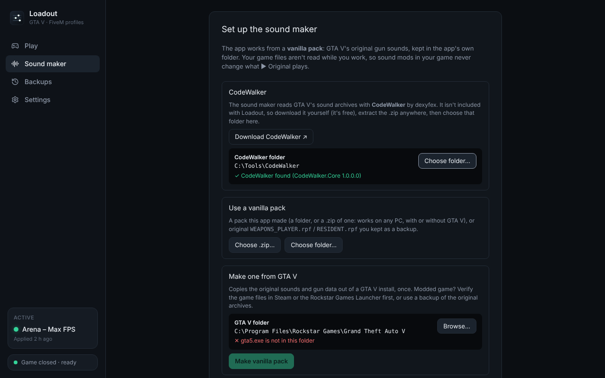

# Sound maker

Loadout's **Sound maker** (in the sidebar) makes **GTA V / FiveM gun sound packs**. It works from a **vanilla pack** of GTA V's original gun sounds, lets you swap in your own gunshots with an in-game-style preview, and rebuilds `WEAPONS_PLAYER.rpf` and `RESIDENT.rpf`. Add them to a profile and Loadout installs them when you play it. It was the separate Gun Soundpack Maker app before.



## CodeWalker

The sound maker reads GTA V's archives with [CodeWalker](https://github.com/dexyfex/CodeWalker) by dexyfex. CodeWalker has no open-source licence, so Loadout doesn't include it:

1. Download CodeWalker from [gta5-mods.com](https://www.gta5-mods.com/tools/codewalker-gtav-interactive-3d-map) (the setup screen has a **Download CodeWalker** button).
2. Extract the .zip anywhere.
3. In the sound maker, **Choose folder…** and pick the folder with `CodeWalker.exe` in it. Loadout checks it holds `CodeWalker.Core.dll` and the SharpDX files.

The bridge is built against a pinned CodeWalker commit. If your CodeWalker is much older or newer, game-file jobs may report that CodeWalker isn't compatible.

## What it does

- **Works from a vanilla pack, not your live game files** (see [Vanilla pack](#vanilla-pack)). The original sounds and gun data live in Loadout's own folder, so sound mods in your game never change what ▶ Original plays, and a vanilla pack works on any PC, with or without GTA V. Game files are read with [CodeWalker](https://github.com/dexyfex/CodeWalker), which you download yourself (see [CodeWalker](#codewalker)). Nothing in your game folder is changed.
- **Lists every gun**, grouped by type and shown with its in-game name. Select one and you see **every file it uses**, under the part of the shot it belongs to (gunshot, rapid fire, distant report, echo, indoor shot, suppressed, casings, heft, reload, slow motion…). Each part says what it does, and each file says what it is and who hears it:

  ```
  GUNSHOT: Single shots: plays every time the gun fires.
   ▶  Layer 1 of 2, plays together with the others, variation 1 of 2 (25% of shots)   You
   ▶  Layer 2 of 2, plays together with the others                                    You
   ▶  The whole gunshot                                                               Others
  ECHO / TAIL: The echo of the shot in reflective places such as tunnels.
   ▶  Close range (20–80 m), left channel                                             Everyone
  ```

  **Heard by** tells you whether a file is part of your own gun, of how other players and NPCs hear it, or both, straight from the gun's data. A replacement changes exactly the files you select; each part has **Select all · Yours · Others' · Only this gun's** to pick quickly. GTA V builds many shots from a gun's own "body" plus generic layers it shares with other guns (for example, the Pistol's gunshot is one file in `ptl_pistol.awc` plus four RESIDENT layers that 17–24 other weapons fire too, and what others hear is a generic NPC pistol sound). Every file shared with another gun says so (**shared with SMG**, **shared with 17 other guns**, or **also Combat MG's slow-mo gunshot** when only a minor part uses it; hover for every gun and part), the gun's own files come first, and the app asks before a change reaches another gun's shot (**Change them too** or **Only this gun's files**). Guns with exactly the same sounds (e.g. a Mk II that reuses the original's) are named at the top of the gun.

- **Previews the shot from the game's data** (see [How the preview is built](#how-the-preview-is-built)).
  - ▶ Original and ▶ Yours play every layer, random variation, level, pitch, delay, filter, mix category, distance curve, crossfade, stereo collapse and envelope the game data defines.
  - Choose how far away you hear it (at the gun up to 300 m), outdoors, indoors or in a tunnel, and who fires it (you, or another player/NPC). Single shots or a burst at the gun's fire rate. Automatic guns play their own rapid-fire sound for every shot, single or burst.
  - It names what it had to approximate (the engine's reverb, where echoes come from…).
  - **Compare with in-game recording…** loads a recording of the real gun (OBS, Audacity…), lines it up with the preview and lets you A/B them.
- **Replaces a whole gun from one file.** Drop a gunshot on the gun's header (or press **Replace whole gun…**) and it goes into every part of the shot: the gunshot and rapid fire take it as it is, and the distant report, echo, indoor and suppressed shot get versions made from it (muffled and with distance reverb for the report, only the reverb tail for the echo, a short room reverb indoors, muffled and quieter when suppressed), so the gun doesn't sound vanilla from a distance. The dialog lists which version fills how many files, lets you listen to each, and leaves files other guns share out unless you tick them in. The made versions are kept as source files (`shot (distant).wav`…) and every part can be fine-tuned or swapped afterwards. Reloads, casings and handling sounds aren't touched.
- **Replaces sounds** with WAV, MP3, OGG, FLAC or M4A. Drop a file onto a part or assign it to a selection: only the selected sounds change. A stereo file fills both sides of an L/R stream pair when you select both. You can also silence or reset sounds.
- **Shapes the audio:**
  - trim leading silence so shots fire instantly
  - start offset and max length
  - fades, gain and peak normalisation
  - resampling (keeps the original rate by default)
  - headroom override
- **Adds your pack to a profile**, or exports rebuilt game archives ready to drag and drop:

  ```
  my_gunpack/
    WEAPONS_PLAYER.rpf   weapon sound banks
    RESIDENT.rpf         shared sound banks
    README.txt           where to put them
  ```

  The app rebuilds each archive from the vanilla pack: every file is copied over, with your changed sound banks swapped in. Only archives with changes are written. They're OPEN (unencrypted) archives, the standard format for mod folders.

- **Identify sounds in game.** **Identify in game…** builds a test pack where every sound says its code, such as "pistol 4". Install it, play, and type what you hear into **What did I hear?** to jump to that sound. This confirms the data in game, and also catches sounds the game code or scripts play by name, which no data file explains. Without a Windows voice, the sounds beep their number instead.
- **Saves projects** as `.gunpack` files. They hold your settings and your own source audio, never game files.
- **Sound banks tab (advanced).** Every bank of both archives, labelled with what uses it (banks no gun uses load from the vanilla pack when you open them). Each sound has a **Used for** column traced through the game's audio data (which gun, explosion, animation or script plays it); filter by what you're after (e.g. "echo") or show only the unused ones. Manual `.awc` and CodeWalker XML import still work.

## Which banks to replace

| Bank                                                                                  | Holds                                    |
| ------------------------------------------------------------------------------------- | ---------------------------------------- |
| `WEAPONS_PLAYER.rpf` → `*.awc` (e.g. `ptl_pistol.awc`, `smg_smg.awc`, `sht_pump.awc`) | Per-gun weapon banks                     |
| `RESIDENT.rpf` → `weapons.awc` and others                                             | Shared banks, used by many guns and NPCs |

**Automatic guns keep their own shot in their rapid-fire sound (AutoSound).** In the game data, the FireSound of every player automatic gun is one shared sound: generic layers in `RESIDENT.rpf`, the same for 22 weapon settings in the base game (SMGs, rifles, MGs, the AP Pistol, the minigun…). NPC versions set it to silence. So for an automatic gun the gun view lists the rapid-fire sound first, as **Gunshot**, and the shared one as **Shared shot layer**. The preview uses AutoSound for both single shots and bursts, without layering FireSound over it. FireSound remains available to play and edit separately; the data does not establish that the engine triggers both together. Any file other guns use too says **shared with …**; changing it changes them all.

Don't go by the archive name alone: a gun's shot can mix files from both archives (community notes describe stock shots split into a left channel in `WEAPONS_PLAYER.rpf` and a right channel in `RESIDENT.rpf`). The gun view's **Heard by** column shows, from the gun's own data, which files you hear and which files other players and NPCs hear.

After a scan, the Sound banks tab labels every bank from the game data, so there's no guessing. Without a scan, bank names marked **?** are inferred from file names.

## How the preview is built

CodeWalker can play the raw files in a bank, but not a gunshot: the game's audio engine builds each shot at runtime from a graph of sound objects, and CodeWalker has no engine to run it. Rockstar hasn't published how its engine plays weapons beyond high-level notes (a shot is about ten layers, mixed by distance, each with its own filter and reverb send). So the app runs the graph itself, following what the game data says. The sound types' meanings come from community research (Monkeypolice188's Monkys-Audio-Research and CodeWalker).

**Taken exactly from the data:**

- header volume, pitch (100 per semitone), pan (degrees), predelay, start offset, filters and variances;
- mix categories (`categories.dat22`): their volume, pitch and filters, up the parent chain;
- distance: the sound's volume curve (`curves.dat16`) scaled by its curve scale and the category's roll-off;
- crossfades (near/far by distance; none, linear or equal power, or their curve) and stereo pairs narrowing to mono with distance;
- random picks by weight (never the same twice in a row), layers, If/Switch branches from the variables the data sets;
- envelopes on volume, pitch, pan or filters, with their curves and output range;
- repeating sounds (start, repeat every DelayTime, stop): an automatic gun's AutoSound, started with the first shot and stopped after the last (a one-shot AutoSound, as NPC guns have, plays with each shot);
- the report's volume and delay deltas; the indoor shot indoors; the gun's echo in tunnels.

**Approximated** (decided by the engine's code, not the data; the preview lists which ones a shot used):

- the reverb itself (outdoor/indoor/tunnel; indoors uses the game's typical interior wetness, delay and filter);
- where echoes come from outdoors (the count, delay and level come from the game's typical environment rule);
- the default distance roll-off for sounds without their own curve, and a few curve shapes;
- game variables the engine sets at runtime (taken as 0);
- occlusion, doppler, the speed of sound, mixer scenes and voice limits (not modelled);
- when shell casings land (physics).

To hear the difference, record the gun in game and use **Compare with in-game recording…**; the ID pack confirms which file plays when.

## How the app knows what a sound is for

The game decides what to play through its audio data:

- **Game objects** (`dat151`) such as a weapon's `WeaponSettings` name a sound for each job: `FireSound`, `ReportSound`, `EchoSound`, `HeftSound`, `ReloadSounds`, `SlowMoFireSound`, and so on (about 50 fields per weapon).
- **Sounds** (`dat54`) form a graph down to the audio files. Each step says when its children play: a crossfade picks near or far by distance, a random pick has weights, a stereo sound has a left and a right, an If chooses a branch.

The scan follows every stream in both archives back up that graph to whatever triggers it. It records the conditions on the way, and reads weapon animation tags (reload clicks…).

Some sounds aren't referenced by any data: the game code or a script plays them by name. The app shows those as "Code or script" (or "Unused" if nothing plays the file at all). The ID pack settles them in game.

Meanings marked "(from the field name)" come from CodeWalker's names for the fields. The data proves the sound is wired to that field, and the ID pack shows exactly when it plays.

Hashes show as `0x…` when their name isn't known. To get more readable names, drop a list of known names (one per line) into `%LOCALAPPDATA%\Loadout\soundmaker\names.txt` and make the vanilla pack again.

## Vanilla pack

The app never reads your live game files while you work. It works from a vanilla pack of GTA V's original gun sounds, kept in Loadout's data folder (`soundmaker\vanilla`). There are two kinds:

| Kind                                   | What it holds                                                                                                                                                                                                        | Needs GTA V?                                  |
| -------------------------------------- | -------------------------------------------------------------------------------------------------------------------------------------------------------------------------------------------------------------------- | --------------------------------------------- |
| **Made by the app** (folder or `.zip`) | `WEAPONS_PLAYER.rpf` and `RESIDENT.rpf` as unencrypted copies with every bank decrypted, an archive of gun banks for DLC wave packs, the gun data (`weapon-index.json`, `sound-map.json`) and `gunpack-vanilla.json` | No: any PC, no keys                           |
| **Original archives**                  | `WEAPONS_PLAYER.rpf` and/or `RESIDENT.rpf` you kept as a backup (anywhere in the folder you pick)                                                                                                                    | Yes, for the decryption keys and the gun data |

### First launch

- **Make one from GTA V.** The app finds GTA V (from FiveM's settings or the usual Steam, Rockstar and Epic folders) or you **Browse…** to the folder with `gta5.exe`. **Make vanilla pack** reads the game once:
  - `weapons.meta`, the audio metadata and the sound banks;
  - extracts and decrypts the banks, and maps what every sound is for;
  - writes the pack and loads it.

  If your game is modded, **verify the game files** in Steam or the Rockstar Games Launcher first. FiveM's and OpenIV's `mods` folders don't count: the app reads the base archives. The app flags an archive that isn't encrypted the way Rockstar ships it, since a mod tool probably rebuilt it.

- **Use a vanilla pack.** **Choose .zip…** or **Choose folder…** picks a pack the app made, or a folder with original archives. With original archives only, the app also needs your GTA V folder; **Make vanilla pack** then turns them into a pack that works without GTA V.

**Change vanilla pack…** (in the gun list) shows what the current pack is, and **Save as .zip…** saves it to move it to another PC.

The app never ships Rockstar's files, and a vanilla pack holds Rockstar's files copied from your own game: keep it for your own use and out of public uploads and repositories. Like CodeWalker, the app reads the decryption keys from your own `gta5.exe`.

## Installing the pack

- **With Loadout:** in **Export**, pick a profile under _Add to a Loadout profile_. The archives go into the profile as FiveM mods, and Loadout puts them in FiveM's mods folder when you play that profile and takes them out for the others.

- **By hand, FiveM:** drag `WEAPONS_PLAYER.rpf` and `RESIDENT.rpf` into `%localappdata%\FiveM\FiveM.app\mods`. To find it: right-click FiveM, choose _Open file location_, then open `FiveM.app\mods`; create the folder if it's missing.
- **By hand, single player (OpenIV):** put both files in `<GTA V>\mods\x64\audio\sfx`. This needs OpenIV.asi.
- **Don't overwrite the originals** in `<GTA V>\x64\audio\sfx`. The exported archives are unencrypted mod archives, and FiveM refuses to start with modified archives in the game folder.
- **To go back to vanilla,** delete the files from the mods folder.

Some servers run in pure mode and block client mods. Test with a second player so you hear both your own shots and other players' shots.

## How it's built

The sound maker lives in `src/soundmaker/`:

| Path                 | Contents                                                                                                                                                                                   |
| -------------------- | ------------------------------------------------------------------------------------------------------------------------------------------------------------------------------------------ |
| `core/`              | Pure TypeScript, fully unit-tested: AWC reader/writer, DSP, weapon index, sound graph and preview planner, usage map, ID pack                                                              |
| `host/`              | The back end (library, vanilla pack, ID pack, project files, export) on a small `Host` interface                                                                                           |
| `host/tauriHost.ts`  | The Host in the app: Tauri commands (`src-tauri/src/soundmaker.rs` → `loadout-core/src/soundmaker.rs`), which may only write to the sound maker's folder, the temp folder and export files |
| `host/memoryHost.ts` | An in-memory Host for `pnpm dev` and screenshots                                                                                                                                           |
| `ui/`                | The React editor, styled under `.soundmaker`                                                                                                                                               |
| `loadout.ts`         | Adds an export to a profile                                                                                                                                                                |
| `../../bridge/`      | The .NET 8 CodeWalker bridge                                                                                                                                                               |

### CodeWalker bridge

`bridge/` is a small .NET 8 command-line program the app runs to read the game and vanilla packs.

- **Commands:**
  - `scan` builds the weapon index and the sound usage map, and extracts the gun banks.
  - `build-rpf` rebuilds `WEAPONS_PLAYER.rpf`/`RESIDENT.rpf` as fresh OPEN archives. It copies every original file (decrypted) and swaps in the replaced banks, then reads the result back to verify it.
  - `list` and `extract` work on banks directly.
  - `make-vanilla-pack` scans the game and writes a self-contained vanilla pack (OPEN archives with AWC-decrypted banks, plus the gun data). `inspect-vanilla` says what a folder holds and flags archives that look rebuilt. `zip` and `unzip` move packs around.
  - Every command that reads sounds takes `--vanilla <dir>`. On its own, it reads a self-contained pack (no `--gta`, no keys). Together with `--gta`, its `WEAPONS_PLAYER.rpf`/`RESIDENT.rpf` replace the install's, including the copies in `update.rpf`.
  - `speak` turns phrases into WAV files with the Windows voices (System.Speech), for the ID pack. It returns `no-tts` elsewhere.
  - All commands output JSON.
- **Building.** `pnpm build:bridge` fetches CodeWalker's source at a pinned commit into `bridge/.codewalker/` (git-ignored) and builds CodeWalker.Core, only to compile against. It then publishes the bridge as a self-contained executable in `src-tauri/bridge/`. `src-tauri/build.rs` builds that into Loadout's exe, which writes it out to `%LOCALAPPDATA%\Loadout\soundmaker\bridge` on first use (so the portable exe has it too).
- **CodeWalker isn't shipped.** The bridge loads `CodeWalker.Core.dll`, `SharpDX.dll`, `SharpDX.Mathematics.dll` and `strings.txt` from the player's CodeWalker folder (`--codewalker <dir>`, or `GSM_CODEWALKER`). `probe-codewalker` checks a folder. The tests point `GSM_CODEWALKER` at `bridge/.codewalker/runtime`.
- **What `scan` produces:**
  - `weapons.meta` → `<Audio>` item → `ItemAudioSettings` (player and NPC variants) → `WeaponSettings` (FireSound, ReportSound, EchoSound, …).
  - The full sound graph behind each of those (Multitrack, Randomized, Envelope, … down to `SimpleSound{ContainerName, FileName}`).
  - Container names resolved to banks via joaat(`<pack>/<bank>`).
  - The mix categories (`.dat22`, with their parent chain) and curves (`.dat16`) those sounds use, every header field, envelope/crossfade/repeat settings, the `Automatic` weapon flag, and typical interior weapon and outdoor echo values (version 3 index).
  - `sound-map.json` (`bridge/Usage.cs`) records:
    - every stream of every `weapons_player`/`resident` bank, with the sounds that play it (SimpleSound, GranularSound channel, AutomationSound MIDI);
    - every ancestor in the sound graph, with its parents and slots and the settings that pick a child (crossfade distances, weights, If/Switch variables, sound set entries…);
    - the game objects whose fields name those sounds, found by reflection over CodeWalker's `dat151` types;
    - animation clip tags in weapon `.ycd` files that name a sound or a sound set entry.

    `src/soundmaker/core/usage.ts` walks it from a stream to every trigger and puts each path into words. `src/soundmaker/core/idpack.ts` builds the ID pack's codes, labels and legend.

- **The preview** (`src/soundmaker/core/soundgraph.ts` → `src/soundmaker/ui/preview.ts`) plans each shot from that graph and renders it with Web Audio.
- **Tests.** The bridge integration tests build a fake GTA V folder with unencrypted RPF archives (`make-test-game`). It contains AWC-encrypted banks (with a test key), audio metadata built from `src/soundmaker/test/fixtures/game/*.rel.xml` (crossfades, stereo pairs, If branches, sound sets, an explosion, a code-only sound), a `weapons.meta` and a weapon clip dictionary with an audio tag. `src/soundmaker/host/vanilla.test.ts` makes a vanilla pack from it and reads it back with no keys at all, imports zipped and plain packs, and checks that original archives win over a modded install. The tests skip themselves when the bridge isn't built.

**CodeWalker licensing.** CodeWalker's source is released "for educational purposes only" and has no open-source license, so Loadout doesn't ship it: players download it themselves. See `THIRD_PARTY_NOTICES.md`.

### AWC format notes

The format knowledge comes from [CodeWalker](https://github.com/dexyfex/CodeWalker)'s `AwcFile.cs` and was checked against real gun packs. The writer reproduces their layout byte for byte:

- Header, then stream table, then chunk table.
- Chunk bodies are ordered: format chunks, then peaks, then markers, then 16-byte-aligned audio data.
- Streams are sorted by id.

When a stream is replaced, the app:

- writes 16-bit PCM (IMA ADPCM for ID-pack labels, so banks stay within their original size)
- sets the real sample count and rate
- rebuilds the peak values
- keeps the stream's id, loop settings, markers and unknown chunks.
